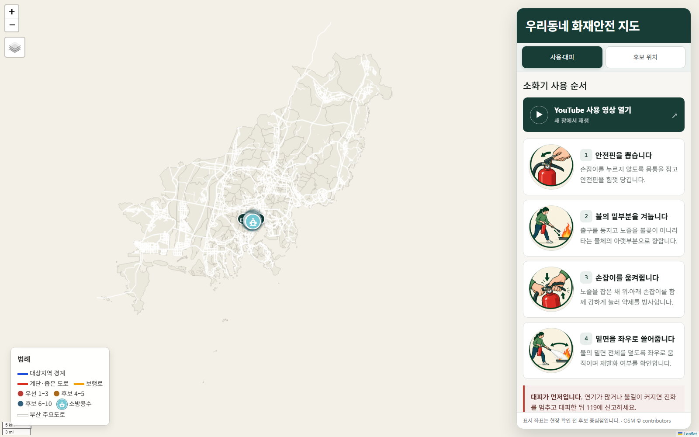

# 우리동네 화재안전 지도

부산 동구 수정제5동의 보행·차량 도로망, 계단·보행길과 건물을 점검하고
인터뷰 기반 가중합(A 50%, B 30%, C 20%)으로 보이는 소화기 설치 검토 지점을
찾는 재현 가능한 GIS 프로젝트입니다. 임의 좌표나 데모 점수는 실제 결과에 쓰지 않습니다.



[보이는 소화기 위치 화면 보기](output/previews/busan-locations.png)

## 실행

```powershell
python -m venv .venv
.\.venv\Scripts\python.exe -m pip install -r requirements.txt
.\.venv\Scripts\python.exe download_data.py --config config.yaml
.\.venv\Scripts\python.exe main.py --config config.yaml
.\.venv\Scripts\python.exe build_qgis_package.py
.\.venv\Scripts\python.exe -m pytest tests -q -p no:cacheprovider
```

SGIS 키가 있으면 `.env.example`을 `.env`로 복사해 값을 입력할 수 있습니다.
키가 없으면 지침에 따라 `ver20241001` GitHub 경계를 사용하며, 보고서에
2026년 현행 경계가 아니라는 경고가 기록됩니다.

현재 작업본은 사용자가 제공한 `input/source_archives/data.zip`에서 필요한 파일만 `input/data_archive/`에
선택 추출해 2025-06-30 행정동 경계와 2026-06 `ROAD_BT` 도로폭을 사용합니다.
`input/source_archives/AL_D010_26_20261009.zip`은 `input/AL_D010_26_20261009/`에 안전하게 풀어
2026-10-09 GIS건물통합정보를 우선 사용합니다. 전체 압축본은 약 4.29GB로
풀지 않으며 원본 ZIP은 변경하지 않습니다.

## 파일 구조

```text
input/source_archives/   원본 ZIP 보관
input/data_archive/      분석에 필요한 선택 추출 자료
input/interviews/        인터뷰 원문
cache/                   API 응답과 재사용 가능한 중간 자료
output/                  지도·후보·품질검증 산출물
docs/reference/          오류 화면 등 설명용 참고자료
reference/PNU-ANCHOR/    상위 분석 저장소의 로컬 참고 사본
tests/                   점수 계산 단위 테스트
```

`input/`, `cache/`, `reference/`, 원본 ZIP과 대용량 중간 산출물은 Git에서 제외합니다.
GitHub에는 재현 코드·설정·문서·테스트와 함께 최종 지도, 후보 목록, 품질검증 결과,
QGIS 패키지와 최신 미리보기만 포함합니다.

신규 Overpass 연결이 불가능하되 이전에 성공한 OSM 캐시가 검증된 경우에만 다음
명령으로 재사용 사실과 실패 원인을 매니페스트에 남길 수 있습니다.

```powershell
.\.venv\Scripts\python.exe download_data.py --config config.yaml --reuse-osm-cache
```

## 산출물

- `cache/download_manifest.json`: API/원본별 성공 여부, 개수, 경로
- `output/candidates.csv`, `output/candidates.geojson`: 75m 이상 이격 후보
- `output/roads.geojson`: 분석에 사용한 OSM 보행도로
- `output/official_roads.geojson`: 후보와 연결한 공식 `ROAD_BT` 도로구간
- `output/map.html`: 부산 전체 행정동·주요도로 배경 위에 빨간 소화기 아이콘 10곳, 그림 사용법과 화재 행동요령을 결합한 주민용 인터랙티브 지도
- `output/report.md`: 평가 규칙, 수집 범위, 한계, 현장 체크리스트
- `output/data_quality.json`: 누락률과 공간 검증 결과
- `output/fire_water_data_quality.json`: 제공된 부산 소방용수 현황 ZIP의 위치정보 품질 점검
- `output/existing_fire_infrastructure.geojson`: 대상지역 안에서 위치 품질을 통과한 소방용수 참고 레이어
- `output/fire_infrastructure_data_quality.json`: 시설 좌표 등급과 공간분석 사용 여부
- `output/road_width_sensitivity.csv`: 3.5m·4m·6m 협소도로 기준의 후보 점수 비교
- `output/qgis/sujeong5_fire_safety.gpkg`: QGIS용 6개 레이어와 기본 스타일
- `assets/extinguisher_4_steps.png`: 오프라인으로 표시되는 소화기 사용 4단계 그림
- `assets/fire_actions_8_steps.png`: 국민안전24 화재 행동요령 8개 카드용 그림

현재 공식 건물 자료로 주거밀집 B점수를 계산하며, 50m 안에 식별된 주거건물이
1동도 없는 노드는 후보에서 제외합니다. `main.py`의 종료 코드 4는 향후 자료 부족으로
완전한 점수 3개 또는 75m 간격 후보 10개를 만들지 못했음을 뜻합니다.

## 현장 가시성 입력

`input/visibility_field.example.csv`를 참고해 `input/visibility_field.csv`를 만들고
현재 후보 ID별 `c_score`(1~5)를 입력하면 C 대리점수를 현장값으로 대체합니다.
후보 ID는 OSM 갱신 후 달라질 수 있으므로 최신 `output/candidates.csv`를 기준으로
작성해야 합니다.

[PNU-ANCHOR](https://github.com/PPPP98/PNU-ANCHOR)의 부산 전역 분석은 수정5동을 우선 검토할 근거로, 이 프로젝트의 50:30:20
가중합은 수정5동 내부 후보 선별에만 사용합니다. 기본 협소도로 기준은 등록폭 4m
미만이며 3.5m·6m 민감도를 함께 출력합니다. 이는 법적·공식 진입불가 판정값이 아닙니다.

이 결과는 설치 우선검토용 후보 구역이며 설치 확정, 기존 시설 부재, 공식적인
소방차 진입불가 판정이 아닙니다. 최저 주거밀도 등급(B=1)은 최종 후보에서 제외합니다.
배경은 외부 지도 타일을 사용하지 않고 부산 전체 행정동·주요도로와 수정5동 상세 건물·도로를 로컬 벡터로
표시합니다. 따라서 `output/map.html`을 파일로 직접 열어도 타일 서버 403이 발생하지 않습니다.
오른쪽의 보이는 소화기 카드를 누르면 해당 중심좌표로 확대되며, 지도 보기·길찾기와
소화기 사용법 탭을 제공합니다. YouTube는 임베드하지 않고 새 창 링크로 열며, 인터넷 연결과 무관하게 로컬
4단계 그림과 설명이 먼저 보입니다. 표시 좌표는 설치가 확정된 기존 소화기 위치가 아니라
현장검증용 후보 중심점입니다.
`open_map.bat`으로 열어도 되지만 필수는 아닙니다.
OSM 보행망 출처: © OpenStreetMap contributors. 공식 경계·도로·건물 자료의 버전과 출처는
`output/data_quality.json`과 `output/report.md`에 별도로 기록합니다.
